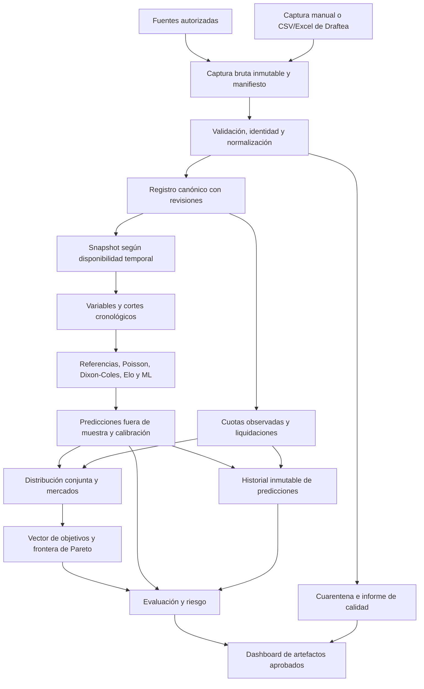

# Arquitectura propuesta

Estado: diseño de F1, pendiente de aprobación. No se han creado los paquetes, dependencias o bases descritos aquí.

Ampliación del 2026-11-24: presupuesto inicial propuesto de **$0 MXN en suscripciones**, evaluación neutral de mercados y optimización multiobjetivo. La revisión preliminar favorable no autoriza F2.

## Principios y flujo

Un monolito modular Python permite estudiar los modelos sin introducir infraestructura distribuida. Los datos, el cálculo y la presentación se separan mediante artefactos versionados. Los proveedores se pueden sustituir sin cambiar la semántica de un partido o mercado.



Hay dos flujos temporalmente separados: producir una predicción con información admisible en su corte y evaluarla más tarde con su resultado. El evaluador puede leer etiquetas futuras; el constructor de variables y el predictor no pueden acceder a ellas.

## Estructura prevista

```text
Modelo_predictivo_futbol/
  AGENTS.md
  README.md
  PLAN.md
  DECISIONES_TECNICAS.md
  docs/
  pyproject.toml                 # Se creará al implementar F2
  configs/                      # Fuentes, calidad, splits y experimentos
  src/futbol/
    contracts/                  # Tipos, unidades y reglas de dominio
    ingestion/                  # Adaptadores y captura manual/CSV/Excel
    normalization/              # Identidad, fechas, unidades y mercados
    storage/                    # Repositorios, migraciones y snapshots
    quality/                    # Validaciones y cuarentena
    features/                   # Variables disponibles al corte
    models/                     # Referencias, Poisson, DC, Elo y ML
    evaluation/                 # Walk-forward, calibración y métricas
    markets/                    # Semántica, margen, Edge y liquidación
    optimization/               # Multiobjetivo, Pareto y metas de multiplicador
    simulation/                 # Monte Carlo y riesgo
    reporting/                  # Informes y exportaciones autorizadas
    cli.py                      # Ejecuciones explícitas y registradas
  apps/dashboard/               # Interfaz local en español
  scripts/                      # Envoltorios operativos, sin lógica duplicada
  notebooks/                    # Explicación sobre datos de desarrollo
  tests/                        # Invariantes relevantes y casos límite
  data/
    raw/                        # Respuestas originales inmutables
    canonical/                  # SQLite y catálogo
    processed/                  # Snapshots Parquet derivados
    quarantine/                 # Errores y referencias a datos rechazados
  artifacts/                    # Modelos, predicciones, métricas e informes
```

En F1 solo existen los documentos y las carpetas vacías preexistentes; este árbol no afirma que el programa esté implementado.

## Componentes y contratos

| Módulo solicitado | Componente Python propuesto | Entrada → salida | Fase |
| --- | --- | --- | --- |
| 1. Recolección | `ingestion` | Configuración autorizada → respuesta bruta + manifiesto | F2 |
| 2. Limpieza y validación | `normalization`, `quality` | Bruto → revisión canónica o cuarentena | F2 |
| 3. EDA y correlaciones | `reporting`, `features` | Desarrollo aprobado → informe y contratos de variables | F3 |
| 4. Poisson | `models.poisson` | Historia admisible → distribución conjunta de goles | F4 |
| 5. Dixon-Coles | `models.dixon_coles` | Historia admisible → distribución corregida | F4 |
| 6. Elo | `models.elo` | Secuencia de resultados publicados → estados previos al partido | F4 |
| 7. ML | `models.ml`, `models.hybrid`, `models.ensemble` | Variables y tasas positivas → probabilidades directas o conjunta de marcadores | F5 |
| 8. Backtesting | `evaluation.walk_forward` | Cortes y política congelados → predicciones/evaluaciones | F4–F6 |
| 9. Calibración | `evaluation.calibration` | Predicciones pasadas fuera de muestra → calibrador | F5 |
| 10. Implícita, Edge y EV | `markets.value` | 1X2/DC/Over/Under/BTTS + precios → candidatos neutrales auditables | F6 |
| 11. Dependencia entre mercados | `markets.joint` | Distribución conjunta + eventos → intersecciones | F7 |
| 12. Parlays | `optimization` | Candidatos, ofertas, objetivos y restricciones → frontera de Pareto o ninguna combinación | F7 |
| 13. Monte Carlo | `simulation.monte_carlo` | Modelo conjunto/escenario → trayectorias y error numérico | F8 |
| 14. Sensibilidad y riesgo | `simulation.risk` | Trayectorias y exposición → indicadores e intervalos | F8 |
| 15. Dashboard | `apps/dashboard` | Artefactos persistidos → vistas explicables | F9 |

Contratos conceptuales, todavía sin código:

- **Observación:** entidad, valor, unidad, revisión, fuente, evidencia, disponibilidad y precisión temporal.
- **Snapshot:** manifiesto de filas/revisiones exactas, política temporal, hashes y decisiones de exclusión. No basta guardar una consulta que más adelante podría devolver otros datos.
- **Fila de variables:** partido, `decision_at`, horizonte, versión de variables y lista/manifestación de revisiones utilizadas.
- **Predicción:** partido, instante de corte, artefactos base/calibrador, probabilidades, soporte, masa de cola y tipo de evidencia. Un clasificador 1X2 no promete una distribución de marcadores que no produce.
- **Cotización:** selección, mercado, periodo, línea, casa, precio decimal, momento observado, disponibilidad, estado y reglas de liquidación.
- **Evaluación:** población y exclusiones, predicciones inmutables, etiquetas y versión, métricas, incertidumbre, escenario y política de capital simulada.
- **Importación Draftea:** lote de captura/CSV/Excel aportado por el usuario, hash, esquema, filas originales, errores, hora observada y de importación, selecciones exactas y semántica de retorno. No implica exportación oficial del operador.
- **Objetivo de multiplicador:** preset o valor personalizado >1, modo mínimo/rango/cercanía, tolerancia, moneda/importe simulado, reglas y universo elegible; no garantiza que exista oferta.
- **Resultado de optimización:** vector `(p_acierto, multiplicador, Edge, EV, incertidumbre, riesgo)`, configuración, cotización, frontera/dominadores y cobertura de búsqueda; valores faltantes explícitos.
- **Escenario:** método, evento perturbado, choque solicitado y efectivo en puntos porcentuales, factibilidad, distribución conjunta resultante, resultados y pertenencia a la frontera.

Los adaptadores no calculan variables predictivas. Los modelos no llaman APIs. El dashboard no entrena, descarga ni ejecuta backtests al abrirse; consume artefactos identificados. No habrá una capa de ejecución de apuestas.

## Mercados neutrales y combinación de objetivos

El catálogo comprende **1X2, doble oportunidad 1X/X2/12, Over, Under y BTTS sí/no**. Recorrer todas las selecciones y líneas observadas de ese catálogo bajo iguales reglas de calidad, tiempo y elegibilidad; no elegir a priori solo Over, favoritos o una familia de mercados. Mostrar cada exclusión: precio ausente, liquidación no soportada, baja calidad o Edge insuficiente. Una familia disponible no prueba que estén todas sus selecciones ni que puedan combinarse en Draftea.

La capa `markets` genera probabilidades compatibles desde una distribución conjunta; `evaluation` contrasta frecuencias simples y mercado sin margen, cuando existe un conjunto adecuado de cuotas. Se separan probabilidad calculable y valor económico calculable. Líneas con push requieren estado de devolución; líneas asiáticas o contratos complejos permanecen visibles como no evaluables hasta validar reglas.

`optimization` conserva las seis dimensiones, con acierto/multiplicador/Edge/EV a maximizar e incertidumbre/riesgo a minimizar. Calcula dominancia y frontera de Pareto antes de aplicar preferencias explícitas. Las métricas no son independientes —EV depende de probabilidad y retorno—; no se duplican ponderaciones de forma implícita. La frontera compara el mismo importe, horizonte, política de liquidación y escenario. Si faltan precios o incertidumbre estimable, se permite exploración parcial etiquetada, no una frontera económica completa inventada.

Configuración de metas: **5x, 10x, 15x, 20x, 30x, 40x y valores personalizados**, expresados como retorno bruto normalizado. Se propone `target_mode=minimum`; alternativas `range` y `nearest` exigen límites/tolerancia explícitos. El objetivo no sustituye restricciones de Edge, EV o riesgo. El resultado «sin ofertas elegibles» es una salida válida. La metodología define estrés ±1/±3/±5 pp y escenarios estadísticos; estos recalculan también la frontera.

F7 construye la frontera con las métricas calculables de manera exacta o por enumeración validada. Si el riesgo exige Monte Carlo aún no validado, se etiqueta como frontera parcial hasta completar F8; no introducir valores provisionales como si las seis dimensiones estuvieran comprobadas.

## Captura manual, importaciones y registro histórico

Flujo previsto: entrada manual o archivo local del usuario → previsualización y mapeo de columnas → contrato versionado → validación/cuarentena → cotización inmutable. Soportar CSV y Excel `.xlsx` como valores, sin ejecutar macros, fórmulas ni enlaces externos. Otros formatos Excel requerirán conversión/soporte expresamente validado; no se presume lectura correcta de cualquier archivo. No crear un libro ni un importador en F1.

Conservar partido(s), mercado, selección, línea, periodo, tipo de apuesta, combinación exacta, multiplicador mostrado y normalizado, hora con zona, evidencia y reglas. Un multiplicador de parlay no se reparte entre sus patas. No se introducen credenciales de Draftea, scraping, pagos ni órdenes. Los detalles del contrato y las pruebas están en [Base de datos](BASE_DATOS.md).

`predictions` se convierte en registro de emisión, no en una tabla de últimas estimaciones: cada fila guarda `generated_at` real, `decision_at`, versiones de modelo/calibrador/datos, probabilidades originales/calibradas, cotizaciones exactas y origen prospectivo/reconstruido. Una predicción sin precio se conserva con ese estado; un precio añadido después no se atribuye retroactivamente a la emisión. Resultados y métricas llegan como eventos/relaciones posteriores sin alterar la proyección original.

## Persistencia y herramientas previstas

| Necesidad | Propuesta | Motivo y límite |
| --- | --- | --- |
| Registro relacional | SQLite con claves foráneas, transacciones y un escritor | Suficiente para un proyecto local; evolución a PostgreSQL con concurrencia real |
| Datos originales | JSON/CSV originales + SHA-256 + manifiesto | Reproducir y revisar cada transformación, respetando retención/licencia |
| Datos analíticos | Parquet inmutable derivado de SQLite | Lecturas eficientes; nunca segundo maestro independiente |
| Consulta analítica | DuckDB opcional sobre Parquet | Incorporarlo cuando el volumen lo justifique, sin duplicar catálogo |
| Transformación y cálculo | pandas, NumPy, SciPy | Construcción de variables y modelos probabilísticos |
| ML y evaluación | scikit-learn | Pipelines y métricas bajo splits temporales propios |
| Validación y pruebas | Contratos Python, pytest; biblioteca de esquemas por decidir | Priorizar controles temporales y semánticos |
| Visualización | Streamlit y Plotly | Propuesta para una interfaz local futura |
| Reproducibilidad | Entorno fijado, configuración versionada, manifiesto de ejecución | Versiones y compatibilidad se comprobarán al implementar |

La selección anterior es una propuesta de herramientas, no una comprobación de sus versiones o capacidades más recientes. F2 fijará versiones, instalación reproducible y política de actualización. Datos/licencias/claves y artefactos voluminosos no entrarán al futuro repositorio Git; se versionarán manifiestos y código.

## Variables y requisitos de datos

| Familia | Definición propuesta | Disponibilidad y limitación |
| --- | --- | --- |
| Localía/visita | Tasas y rendimiento del equipo como local/visitante; neutralidad separada | El equipo listado primero puede jugar en sede neutral |
| Goles | Anotados/recibidos por partido de 90 minutos; tasas con exposición definida | Solo resultados finalizados y publicados antes del corte |
| xG/xGA | Agregados históricos de un proveedor y definición homogéneos | No intercambiables entre proveedores; publicación y revisiones pueden faltar |
| Forma 5/10/20 | Ventanas de últimos partidos admisibles, con contadores y cobertura | Marcar historia corta por ventana |
| Rival | Estado Elo o fuerza estimada con historia pasada | No usar ranking final o fortaleza calculada con toda la temporada |
| Lesiones/suspensiones | Estados conocidos, certeza y elegibilidad; asociación con xG/xGA futuros y probabilidades | Requiere historia admisible, minutos/roles/reemplazos y contexto; sin penalización fija inventada ni causalidad supuesta |
| Alineaciones/rotación | Cambios de titulares y continuidad/minutos frente a historia previa; prevista o confirmada | Confirmada solo si su publicación precede al corte; comparar con rivales/descanso y no inferir causa de ausencia |
| Descanso/carga | Tiempo desde encuentro previo y minutos/partidos recientes | Necesita copas y otras competiciones del equipo; con calendario parcial indicar límite |
| Cuotas | Precio completo y vigente en el horizonte elegido | Cierre posterior solo para evaluación; nunca rellenar historia con precio actual |

El MVP estadístico puede comenzar más adelante con goles, localía y secuencia histórica aprobada. Cada ampliación de datos habilita un conjunto distinto de variables y exige una auditoría nueva; no se mezcla automáticamente con experimentos anteriores.

## Niveles predictivos y actualización

El **modelo base** usa resultados, localía y rendimiento visitante, goles, ataque/defensa, forma 5/10/20, Elo, calidad del rival y rendimiento por competición. Descanso y carga requieren un calendario con cobertura suficiente. El **avanzado** añade xG/xGA, bajas, suspensiones, convocatorias, onces probables y confirmados, rotaciones, fatiga, minutos, rendimiento individual, calidad de sustitutos, cambios de entrenador, formaciones y contexto competitivo verificable. El nivel es un contrato de datos. Cualquiera de los niveles puede usar un estimador estadístico o de ML. La activación será gradual por competición, temporada y horizonte. Véase [Feature engineering](FEATURE_ENGINEERING.md).

El catálogo incluye Poisson, Dixon-Coles, Elo y regresión logística. XGBoost, LightGBM, Random Forest y Extra Trees se evaluarán con búsqueda y regularización cronológicas. Un híbrido estima tasas positivas con ML y construye una matriz de marcadores con Poisson o Dixon-Coles. Un ensemble puede mezclar salidas compatibles con pesos estimados fuera de muestra. El contrato de salida distingue probabilidades 1X2 de distribuciones conjuntas. El registro de experimentos incluye calibrador, métricas de promoción, importancia de variables y explicaciones SHAP en la escala declarada.

| Corte | Actualización prevista |
| --- | --- |
| T−24 h | Predicción inicial. |
| T−3 h | Convocatorias, bajas y onces probables disponibles. |
| T−60 min | Onces confirmados, rotaciones, novedades y cuotas disponibles. |

Cada corte genera su propio snapshot, versión de predicción y calibrador validado con el mismo horizonte. El horario de referencia procede de la revisión que se conocía al programar el corte. Un aplazamiento da lugar a una emisión nueva o cancelación trazable. Si faltan datos avanzados, usar el modelo base habilitado para ese corte cuando exista. Una emisión previa permanece en el historial y una actualización tardía se registra con su hora real.

## Ruta de datos del piloto de $0 MXN

Prioridad propuesta: históricos OpenFootball con licencia CC0 y cobertura por auditar; football-data.org Free para contraste de calendarios/resultados accesibles. StatsBomb Open Data solo en investigación separada y API-Football Free como prueba opcional limitada por temporadas/campos. No hay fuente única gratuita confirmada para toda la información requerida. Las fuentes de pago quedan como alternativas futuras fuera del piloto, según [Fuentes](FUENTES_DATOS.md).

El primer modelo, después de aprobar calidad y protocolo, estimaría resultados a partir de goles, localía y fuerza histórica, sin ajustes por lesión, xG continuo o rotaciones no observables. Su evaluación sería reconstruida donde no se demuestre disponibilidad pasada; sin cotizaciones comparables no habría validación económica ni benchmark de mercado para esas filas. La captura manual futura de ofertas permite seguimiento prospectivo, sin rellenar huecos históricos.

## Operación y fallos previstos

Adaptadores con paginación, reintentos limitados, backoff para 429/errores transitorios, presupuesto máximo de llamadas, caché permitida y logs sin secretos. La clave se obtiene del entorno; nunca se escribe en URLs de manifiestos ni mensajes de error. Un cambio de esquema detiene ese adaptador y envía registros a cuarentena en lugar de rellenar silenciosamente columnas.

Publicar snapshots de manera atómica después de QA. Mantener un único escritor en SQLite; agentes pueden investigar o generar artefactos independientes en paralelo. Evitar tareas programadas hasta que estén autorizadas. Si una fuente falla, el informe conserva la antigüedad del último dato y puede responder «datos insuficientes».

## Límites de evolución

No se presupone acceso íntegro a históricos de lesiones, xG o cotizaciones combinadas. No se modelan inicialmente córners, tarjetas ni jugadores con una distribución de goles. No se añaden servicios distribuidos, GPU o un optimizador complejo sin una necesidad medida. Toda nueva fase conserva el protocolo de aprobación de [PLAN](../PLAN.md).
