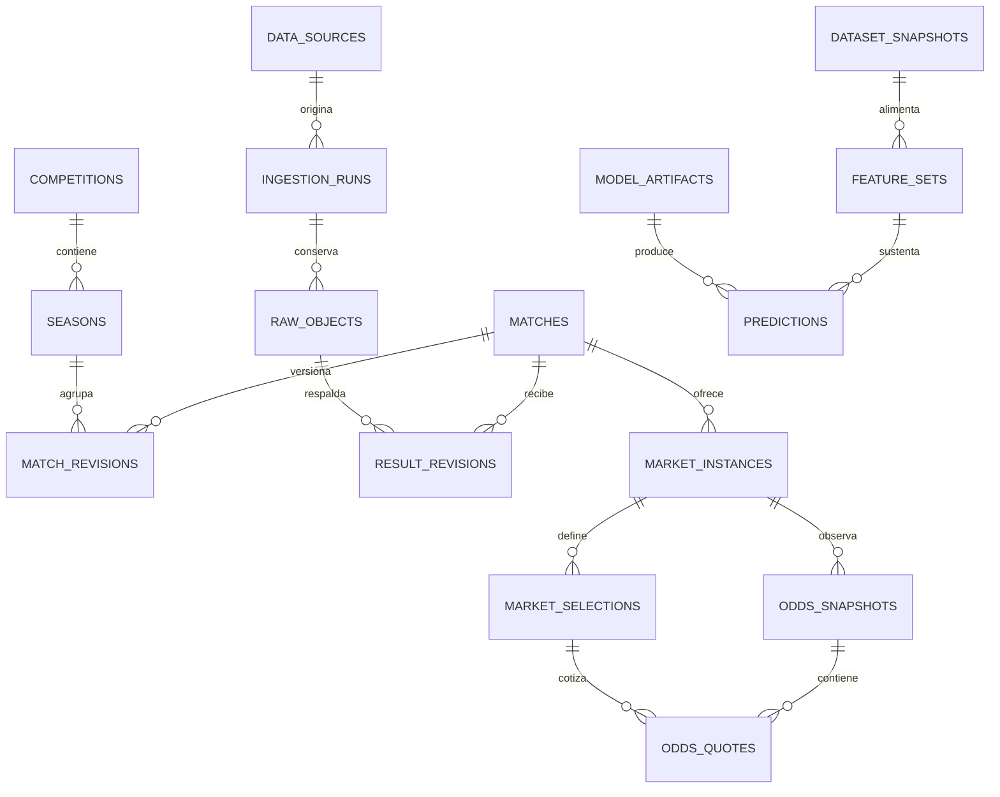

# Propuesta de base de datos y contratos temporales

Estado: esquema lógico de F1. No se ha ejecutado DDL ni creado una base. Los nombres técnicos usan `snake_case`; las descripciones y futuras interfaces serán en español.

La ampliación incluye importación manual/CSV/Excel de Draftea, historial de emisiones y optimización multiobjetivo. F2 sigue sin autorización; el presupuesto inicial propuesto es $0 MXN en suscripciones.

## Convenciones de identidad, tipos y tiempo

Claves internas estables, independientes de nombres o IDs de proveedores; claves foráneas obligatorias cuando se indica una relación. Usar fechas/instantes UTC en ISO 8601 con zona o representación entera definida; conservar zona/precisión original. Separar temporada deportiva de año natural. Goles como enteros no negativos. Cuotas y líneas como decimales de precisión definida; al usar SQLite, almacenar texto decimal canónico o enteros escalados con escala explícita, evitando redondear contratos de mercado. Las probabilidades calculadas pueden usar doble precisión con tolerancias documentadas.

`NULL` expresa desconocido/no disponible y se acompaña de motivo cuando afecte la interpretación; nunca significa cero ni ausencia de lesión. No asignar medianoche a una fecha sin hora. Una migración futura elegirá tipos físicos y los validará; no habrá columnas JSON sin contrato para esconder campos críticos.

## Sobre temporal común de una revisión

Toda tabla terminada en `_revisions`, y las observaciones de cuotas equivalentes, incorporará:

| Campo | Significado |
| --- | --- |
| `revision_id` / `supersedes_id` | Identidad inmutable y revisión anterior, si existe |
| `source_id`, `raw_object_id`, `source_record_id` | Proveedor, respuesta bruta e identidad externa |
| `event_at` / `valid_from`, `valid_to` | Hecho o periodo al que se refiere el dato; no implica publicación |
| `source_published_at` | Publicación de esta revisión, cuando esté documentada |
| `source_observed_at` | Momento del snapshot del proveedor, si existe |
| `ingested_at` | Recepción local real; nunca retrofechada |
| `available_at` | Primer instante admisible sustentado por evidencia; puede ser nulo |
| `availability_basis` | `verified_publication`, `archived_snapshot`, `own_capture`, `user_reported`, `inferred`, `unknown` |
| `evidence_uri`, `policy_version` | Evidencia y regla que justifican disponibilidad/admisión |
| `time_precision`, `revision_hash` | Resolución temporal y hash de contenido normalizado |

Las revisiones son append-only: una corrección añade una fila, no modifica un pasado ya utilizado. `valid_to` de una historia se puede derivar de la revisión siguiente; no borrar la evidencia anterior. La resolución de identidad y los cambios de membresía también se versionan.

**Tres perfiles de evaluación:**

1. **Captura operativa:** exige `ingested_at <= decision_at` y dato admisible; representa lo que este sistema había recibido realmente.
2. **Reconstrucción verificable:** un archivo histórico puede descargarse hoy y usarse para un corte pasado solo si prueba la misma revisión y su disponibilidad anterior. No se afirma que nuestro sistema la hubiera recibido entonces.
3. **Reconstrucción bajo supuestos:** disponibilidad inferida, revisión histórica incierta o calendario sin precisión. Se analiza por separado; no se etiqueta como ejecución histórica verificable. Lo desconocido queda excluido del perfil estricto.

No fijar `available_at = event_at`. Una demora supuesta tras el partido puede ser un escenario de sensibilidad, pero no transforma una revisión actual de xG en evidencia histórica.

Una hora de observación escrita por el usuario en un CSV es `user_reported` hasta corroborarla; no se transforma en snapshot verificable por tener formato ISO 8601. La fecha de importación demuestra cuándo recibimos el archivo, no cuándo existió la oferta. Conservar evidencia, nivel de verificación y cualquier demora entre observación, registro y decisión.

## Procedencia y núcleo deportivo

En las tablas siguientes `PK` indica clave primaria y `FK` referencia. Los campos del sobre temporal se omiten en las filas por brevedad.

| Tabla y granularidad | Campos principales y restricciones |
| --- | --- |
| `data_sources` — proveedor | `source_id PK`, nombre, URL, capacidades; no contiene claves secretas |
| `source_terms_versions` — versión de condiciones | `terms_id PK`, `source_id FK`, URL, consulta, hash cuando se conserve legalmente, derechos de almacenamiento/ML/redistribución, límites y pendientes |
| `ingestion_runs` — ejecución | `run_id PK`, `source_id FK`, `terms_id FK`, adaptador/versiones, parámetros sin secretos, inicio/fin, estado, consumo, errores |
| `raw_objects` — respuesta/archivo | `raw_object_id PK`, `run_id FK`, URI local, formato, SHA-256, fecha de captura, paginación y tamaño; hash único dentro de la política de deduplicación |
| `competitions` — identidad | `competition_id PK`, nombre, país/ámbito, categoría, género, organizador |
| `seasons` — edición | `season_id PK`, `competition_id FK`, etiqueta; `UNIQUE(competition_id, etiqueta)` |
| `competition_format_revisions` — reglas de edición | `season_id FK`, formato, fases, número de equipos/partidos esperado por fase, fechas y reglas; no extrapolar un conteo a todas las temporadas |
| `teams` — identidad | `team_id PK`, nombre canónico, país; no deduplicar solo por texto |
| `source_entity_mappings` — identidad externa versionada | fuente, tipo, ID externo, ID canónico, vigencia, método, evidencia y estado; sin dos asignaciones activas incompatibles para la misma clave externa |
| `matches` — identidad estable | `match_id PK`; no usar pareja de equipos + fecha como identidad única universal |
| `match_revisions` — calendario/estado | `match_id FK`, `season_id FK`, fase, ronda, ida/vuelta, eliminatoria, local/visitante FK, hora prevista, sede, neutralidad y estado |
| `result_revisions` — resultado | `match_id FK`, goles al descanso, 90 minutos, prórroga y tanda por separado, `completed_at`, marcador jugado/adjudicado, estado oficial |

Los nombres y horarios cambian; los identificadores internos se conservan. Un mismo par de clubes puede jugar varias veces; una reprogramación conserva el partido mientras una repetición oficial puede requerir otra identidad relacionada. Conservar relaciones de eliminatoria permite distinguir marcador del partido de global agregado.

La precedencia entre fuentes es una política por campo y periodo, con discrepancias registradas; no elegir a posteriori el dato que mejora resultados del modelo. El marcador de mercado puede depender del resultado jugado y de reglas distintas a una adjudicación administrativa.

## Estadísticas y disponibilidad de jugadores

| Tabla | Campos principales y restricciones |
| --- | --- |
| `stat_definitions` | `stat_definition_id PK`, nombre, unidad, proveedor, metodología/versionado disponible, periodo; xG de distintos proveedores son definiciones distintas |
| `team_match_stat_revisions` | partido/equipo/definición FK, valor, periodo; xG y xGA coherentes dentro de la misma fuente/definición, sin exigir igualdad entre proveedores |
| `players` | `player_id PK`, identidad y alias mediante mappings |
| `player_membership_revisions` | jugador/equipo FK, intervalo de pertenencia, tipo y evidencia; no aplicar plantilla actual a una temporada pasada |
| `player_status_revisions` | jugador/equipo FK, partido/competición si aplica, lesión/suspensión/duda, certeza, inicio/fin conocidos, motivo documentado |
| `lineup_revisions` | `lineup_id PK`, partido/equipo FK, prevista/confirmada, formación y sobre temporal |
| `lineup_members` | `lineup_id FK`, jugador FK, titular/suplente, posición; unicidad de jugador dentro de esa revisión |
| `squad_callup_revisions` | partido/equipo, convocatoria versionada, jugadores y evidencia de publicación |
| `coach_assignment_revisions` | entrenador, equipo, vigencia, anuncio, publicación y condición interina |
| `competition_context_revisions` | temporada/fase, tabla conocida, eliminatoria, global previo, desempates, partidos restantes y origen de cada revisión |
| `lineup_scenarios` | partido/equipo/corte, XI completo, formación, roles, sustituciones plausibles, pesos si son estimables y artefacto de generación |

Para estudios posteriores añadir `player_match_stat_revisions` (jugador/partido/definición/periodo, minutos, rol y métricas disponibles) y `team_context_feature_rows` (partido/corte, jugadores elegibles/ausentes, causa documentada, reemplazos previstos, titulares cambiados y denominadores). Las rotaciones derivadas mantienen los IDs de alineaciones previas utilizadas y su disponibilidad. El objetivo xG/xGA observado después del partido reside en estadísticas/etiquetas separadas; los cambios proyectados de xG y sus intervalos pertenecen al artefacto experimental, nunca a la tabla de observaciones reales.

Alineaciones como conjuntos versionados evitan mezclar titulares de publicaciones distintas. No inferir lesión solo porque un jugador no aparece. Los minutos jugados de un encuentro se conocen después y no entran como variable de ese mismo encuentro.

## Mercados, precios y liquidación

| Tabla | Granularidad y campos |
| --- | --- |
| `bookmakers` | `bookmaker_id PK`, nombre, ámbito/región y tipo casa/exchange |
| `settlement_rule_versions` | `rule_id PK`, proveedor/casa, periodo, anulaciones, aplazamientos, prórroga, comisiones, vigencia y evidencia |
| `market_definitions` | `market_definition_id PK`, familia (1X2, doble oportunidad, Over/Under, BTTS), periodo, definición del evento, conjunto de resultados, tipo de línea y si la familia forma partición excluyente |
| `market_instances` | `market_id PK`, partido FK, definición FK, línea exacta y unidad; impedir duplicación semántica |
| `market_selections` | `selection_id PK`, mercado FK, clave local/empate/visitante/1X/X2/12/over/under/sí/no; unicidad dentro del mercado y predicado formal sobre resultados |
| `odds_snapshots` | `snapshot_id PK`, mercado/casa/regla FK, instante del proveedor, última actualización, ingesta/disponibilidad, estado prepartido/en vivo/suspendido, completitud y caducidad evaluada |
| `odds_quotes` | snapshot/selección FK, cuota decimal >1 finita, estado, límites de importe si están disponibles; `UNIQUE(snapshot_id, selection_id)` |
| `settlement_revisions` | selección/regla/resultado FK, win/loss/push/void/half-win/half-loss, fecha y fracciones de importe ganado/perdido/devuelto; también versionada. El retorno monetario se calcula para cada ticket con su cuota concreta |
| `combination_quotes` | `combination_quote_id PK`, casa, hash de selecciones ordenadas, cuota conjunta ofrecida, hora, disponibilidad, restricciones y regla FK |
| `combination_quote_legs` | combinación/selección FK y orden canónico; sin duplicados; conjunto exacto, no solo contador |

El catálogo conserva todos los mercados observados del alcance y su estado `supported`, `not_supported`, `missing_price` o `invalid_contract`, con motivo. Doble oportunidad no es una partición de tres resultados excluyentes. Para Over/Under registrar línea y estados de devolución; no equiparar una línea entera con una media línea.

Para quitar margen se necesita un conjunto exhaustivo, mutuamente excluyente y contemporáneo del mismo mercado y casa. Mantener cada `last_update` permite detectar una respuesta API con precios internamente desalineados. La tolerancia de antigüedad se fijará por fuente, horizonte y frecuencia en F3; no completar precios faltantes con otra casa o con otro día.

Invariantes entre tablas: la selección de una `odds_quote` debe pertenecer al mercado de su snapshot; una liquidación debe referirse al resultado del partido de esa selección y a reglas compatibles con su periodo. Las patas de una combinación comparten casa/oferta y su conjunto exacto coincide con la cotización, aunque puedan pertenecer a distintos partidos. Las claves foráneas aisladas no bastan: F2 deberá implementarlo mediante claves compuestas o validaciones transaccionales.

El mercado inicial es tiempo reglamentario con descuento, sin prórroga ni tanda. El dato llamado `full_time` por un proveedor se debe verificar contra esa definición: no asumir equivalencia. Mercados con devoluciones parciales quedan excluidos del MVP hasta validar su liquidación. Una combinación sin cotización observada puede recibir una probabilidad, pero no un EV comercial verificable.

## Contrato de captura manual e importación CSV/Excel Draftea

Propuesta de formato interno del proyecto, **no una exportación oficial confirmada**. Aceptar captura en formulario, CSV UTF-8 o Excel `.xlsx` con valores explícitos; no ejecutar macros, fórmulas ni vínculos externos. Otros formatos requieren conversión validada. El usuario puede aportar cotizaciones sin realizar apuestas. F1 no crea plantilla, importador ni registros reales.

| Tabla | Campos y reglas |
| --- | --- |
| `manual_import_batches` | `batch_id PK`, fuente Draftea, `input_kind` manual/csv/xlsx, esquema, hash de archivo o captura, nombre local, delimitador/locale/hoja, zona por defecto declarada, `imported_at`, conteos y estado |
| `manual_import_rows` | lote FK, hoja/fila o ID de captura, texto/valores originales, hash, errores, estado pendiente/aceptado/cuarentena y referencias a cotización/selecciones creadas; sin datos de cuenta o pago |
| `quote_evidence` | evidencia URI/hash autorizado, `observed_at_declared`, `recorded_at`, zona original, grado de verificación, reglas/versiones; no usar la fecha de modificación del archivo como hora de cuota |
| `quote_price_details` | cotización simple o conjunta FK, valor/texto mostrado, formato decimal/americano, `return_basis` bruto/neto/desconocido, multiplicador bruto normalizado nullable, oferta ordinaria/promoción, regla de conversión y revisión |

Campos mínimos por oferta: `capture_id`, fuente, hora observada y zona, partido(s) identificables (competición, equipos, fecha/hora o ID resuelto), mercado, selección, línea cuando aplique, periodo, tipo simple/combinación, valor y formato de momio, base de retorno, evidencia/reglas. En archivo de combinaciones, usar `quotes` y `legs` en Excel o dos CSV relacionados por `capture_id`; una cotización conjunta y su conjunto exacto de patas. En captura manual, el formulario produce el mismo contrato. Si se admite una sola tabla plana, el precio repetido por pata debe coincidir y se almacena una sola vez.

Normalización propuesta: un momio decimal bruto es retorno total por unidad, incluidas las unidades comprometidas; un multiplicador declarado neto solo se convierte a bruto mediante `M_bruto=M_neto+1` si el contrato ordinario confirma esa interpretación. Para momio americano `a>0`, `M=1+a/100`; si `a<0`, `M=1+100/abs(a)`; cero es inválido. No adivinar si una cadena `10x` significa retorno bruto, ganancia neta o promoción. Las promociones/freebets y las bases desconocidas quedan fuera del MVP económico hasta validar sus reglas.

Pruebas de aceptación del futuro importador:

- Campos y formatos válidos, cuota decimal finita >1, zona resuelta, identidades inequívocas, línea/periodo/reglas compatibles; errores por fila con motivo, sin completar datos inventados.
- Distinguir separador decimal y miles mediante locale declarado; rechazar valores ambiguos, fórmulas y macros. Vista previa antes de confirmar persistencia local; reimportar el mismo lote no duplica observaciones.
- Cotización conjunta única por captura, sin patas duplicadas; participantes y selección coinciden con cada partido. Una cuota conjunta no permite deducir cuotas individuales ni margen del mercado.
- Correcciones crean revisión enlazada; no sobrescribir la captura original. Precio temporalmente no admisible se conserva como evidencia, pero no se incorpora al backtest correspondiente.
- Registrar catálogo observado y completitud de 1X2, doble oportunidad, ambos lados de totales y BTTS, sin exigir que Draftea ofrezca todo en todos los partidos. La ausencia no es precio cero.
- Respetar antigüedad y perfil temporal de [Metodología](METODOLOGIA_Y_RIESGOS.md). La importación no inicia sesión ni envía órdenes a Draftea.

## Snapshots, aprendizaje y experimentos futuros

| Tabla | Contenido |
| --- | --- |
| `dataset_snapshots` | `dataset_id PK`, URI/hash de manifiesto y archivos, fuentes/términos, esquema, perfil temporal, cobertura y exclusiones |
| `snapshot_members` | snapshot, tipo de observación, revisión exacta o manifiesto externo inmutable con hash; evita reconstruir a partir del «último estado» |
| `quality_runs`, `quality_findings` | dataset/lote, reglas/versiones, severidad, fila/objeto, hallazgo y resolución de cuarentena |
| `feature_definitions`, `feature_sets` | fórmula/versión, unidad, ventana, política de faltantes, dataset y código |
| `feature_eligibility` | variable/fuente/competición/temporada/nivel/horizonte, cobertura, evidencia de disponibilidad, estado, motivo y versión de aprobación |
| `prediction_cuts` | partido, revisión de calendario, hora prevista conocida, etiqueta T−24h/T−3h/T−60min, corte UTC, estado y motivo de reprogramación |
| `absence_impact_estimates` | jugador/rol/partido/corte, onces de referencia y alternativo, pérdida xG propio, aumento xGA, intervalos, umbral 0.20 configurable, estado y versión del estimador |
| `feature_rows` | partido/corte/conjunto de variables, URI de matriz, hash y manifiesto de revisiones causales; unicidad por versión |
| `split_definitions` | límites UTC de ajuste, selección, calibración y prueba; agrupación simultánea, política de actualización y embargo justificado |
| `experiment_runs` | código/hash o commit futuro, entorno, configuración, semilla, splits, dataset, objetivo, estado y artefactos |
| `model_artifacts` | familia, nivel, horizonte, parámetros/regularización, ventana de ajuste, etiquetas admisibles, hash, pesos de ensemble si aplica y calibrador con ID/ventana propios |
| `predictions` | `prediction_id PK`, partido, `generated_at` real, `decision_at`, horizonte, `prediction_kind` prospectiva/reconstruida, modelo/versión, calibrador nullable, dataset/feature row, configuración, distribución original/calibrada, soporte y perfil temporal; inmutable |
| `prediction_quote_links` | predicción FK, cotización simple/conjunta exacta FK nullable, momento de enlace, rol contemporánea/comparación_posterior, Edge/EV nullable, motivo de ausencia; no retroatribuir al corte un precio añadido después |
| `prediction_outcomes` | predicción FK, revisión de resultado/estado de selección, `evaluated_at`, reglas, métricas y revisiones de evaluación; sin modificar la probabilidad emitida |
| `evaluation_runs`, `evaluation_metrics` | predicciones/etiquetas exactas, población, métrica, unidad, valor nullable, intervalo, método, muestra y motivo de no evaluabilidad |
| `parlay_candidates`, `parlay_legs` | corrida, selecciones, probabilidad conjunta, cotización FK nullable, método de dependencia, restricciones, Edge/EV y razones de descarte |
| `simulation_runs`, `paper_portfolio_events` | escenario, semilla, modelo conjunto; cada ticket simulado enlaza selección o combinación, cotización exacta, importe y reglas; eventos de reserva, liquidación, retorno monetario, costes y saldo |

Las emisiones en distintos horizontes o con nuevas versiones crean filas distintas, aunque correspondan al mismo partido. Conservar probabilidades proyectadas originales; una corrección indica `supersedes_prediction_id` sin eliminar la emisión anterior. El registro guardará candidatos no seleccionados y predicciones sin precio para impedir selección retrospectiva de aciertos. Etiquetas corregidas actualizan una versión de evaluación, no reescriben el pasado del modelo.

Enlazar cada emisión al corte programado, al nivel solicitado y al nivel emitido. Si se usa el nivel base por falta de datos avanzados, guardar el motivo y el calibrador de base del mismo horizonte. Cada conjunto de validación registra la pertenencia a bloque externo por partido, común a los tres cortes. Las variables derivadas conservarán revisiones de origen y tiempo efectivo de disponibilidad. La definición de cada índice está en [Feature engineering](FEATURE_ENGINEERING.md).

## Multiobjetivo, Pareto y escenarios

| Tabla | Contrato previsto |
| --- | --- |
| `optimization_configs` | presets **5x/10x/15x/20x/30x/40x** o valor personalizado >1; retorno bruto, modo mínimo/rango/cercanía, límites/tolerancia, referencia/alcance de Edge, filtros, importe/banca/horizonte, métricas de incertidumbre/riesgo y versión |
| `optimization_runs` | configuración FK, predicciones/cotizaciones/snapshot, instante de decisión, algoritmo y versión, semilla, universo enumerado, exclusiones y estado exacto/aproximado/parcial |
| `candidate_objectives` | candidato/corrida/escenario FK, `p_hit`, `multiplier_gross`, `edge`, `ev_net`, `uncertainty_width`, `risk_value`, unidades/direcciones, intervalos y motivos de valores no evaluables |
| `pareto_memberships` | corrida/escenario/candidato FK, frente/rango, dominador cuando exista, tolerancias, exacta/heurística; conservar candidatos dominados para auditar |
| `scenario_definitions` | central/estrés/estadístico, método de distribución, semilla/configuración, shock objetivo **±0.01/±0.03/±0.05**, evento afectado, valor original/objetivo/efectivo, factibilidad y evidencias |
| `scenario_results` | escenario/candidato FK, vector recalculado, incertidumbre y riesgo, cumplimiento de meta/Edge, pertenencia Pareto, hash de distribución y pruebas de coherencia |
| `benchmark_predictions` | frecuencia simple o mercado sin margen, partido/corte/evento, datos/cuotas exactas, método/versión, probabilidad y cobertura; clasificación directa/derivada/no evaluable |

`uncertainty_width` es anchura de intervalo de probabilidad con método/nivel declarados; no es un choque fijo de sensibilidad. `risk_value` exige definición de pérdida, importe, cartera y horizonte comunes, por ejemplo CVaR al 95 %. No reemplazar un objetivo desconocido por cero: excluir de la frontera completa y permitir una vista parcial etiquetada. La matriz de [Metodología](METODOLOGIA_Y_RIESGOS.md) fija las identidades de mercados y la relación entre objetivos; una corrida no puede mezclarlos con escalas distintas sin dejar constancia.

Las tablas de escenarios almacenan supuestos y resultados simulados separados de cuotas/probabilidades observadas. Una meta solicitada no es una cotización ni evidencia de factibilidad. Las cotizaciones normales/promocionales no se comparan sin un contrato de pago compatible.

Las predicciones guardan `decision_at` separado de la fecha real en que se computa el backtest. El artefacto puede crearse hoy, pero sus insumos/etiquetas deben satisfacer el corte histórico del protocolo. Una predicción futura real además requiere captura operativa.

## Relaciones principales

El diagrama resume relaciones; las tablas anteriores definen revisiones y restricciones adicionales.

## Consulta a fecha de corte

Procedimiento de diseño para cada predicción con corte `T`:

1. Recuperar calendario y horario que eran conocidos al generar la decisión, no simplemente el horario definitivo. Registrar una política explícita para aplazamientos y regeneración/cancelación de predicciones.
2. Filtrar observaciones por perfil temporal, `available_at <= T` y evidencia válida. En captura operativa exigir además `ingested_at <= T`.
3. Para cada clave lógica y proveedor, seleccionar la última revisión admisible; resolver conflictos según política preregistrada. No seleccionar primero el último registro actual y después comprobar su fecha.
4. Para forma, Elo y goles, exigir finalización y publicación del resultado previo antes de `T`. Para entrenamiento, exigir lo mismo a cada etiqueta antes del corte de ajuste.
5. Separar etiquetas del partido objetivo y todas sus estadísticas posteriores. Las alineaciones/cuotas del objetivo pueden entrar solo si son prepartido y admisibles en `T`.
6. Persistir revisiones elegidas, versión de código/política, exclusiones y hashes. Las revisiones posteriores no reescriben el snapshot.

Índices previstos: `(entidad, source_id, available_at)`, `(match_id, available_at)`, `(market_id, bookmaker_id, source_observed_at)`, `(match_id, decision_at, model_id)` y hashes/IDs externos. Medir rendimiento antes de añadir particiones o cambiar de motor.

## Pruebas de integridad previstas para F2

Casos obligatorios: partido aplazado, fecha sin hora, sede neutral, marcador con prórroga/tanda, corrección posterior de resultado/xG, alias ambiguo, incorporación tardía de alineación, lesión sin publicación, respuesta parcial de cuotas y dos ejecuciones idénticas de ingesta. En perfiles estrictos, insertar una revisión posterior nunca debe cambiar una fila de variables ya congelada. Toda violación se bloquea o queda en cuarentena; las condiciones completas de aprobación están en [PLAN](../PLAN.md).
